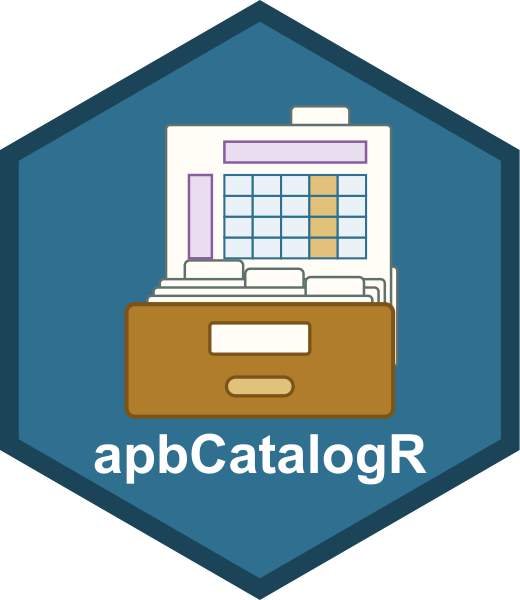

# apbCatalogR 

[](https://doi.org/10.5281/zenodo.23928865)

apb-catalog's API in R: look up the fields of an [APB](https://github.com/anndata-omics-bridge/apb2) result by meaning, such as a PEP or an unnormalized intensity, without naming vendor columns.

> **New API.** This package is new, and its API may still change between releases. Feedback is very welcome: open an [issue](https://github.com/anndata-omics-bridge/apbCatalogR/issues) with what you need, what surprised you, or what broke.

Documentation: [anndata-omics-bridge.github.io/apbCatalogR](https://anndata-omics-bridge.github.io/apbCatalogR/), with the [vignette](https://anndata-omics-bridge.github.io/apbCatalogR/vignettes/apbCatalogR.html) as the walkthrough.

Catalog viewer: [fgcz-ms.uzh.ch/public/apb-catalog](https://fgcz-ms.uzh.ch/public/apb-catalog/), every set with its entries, requirements and coverage, in the browser.

Contributing: the sets can be extended to suit your application, and you are welcome to create your own; see [Contributing](https://anndata-omics-bridge.github.io/apb-catalog/contributing/).


## APB

The AnnData Proteomics Bridge, [apb2](https://anndata-omics-bridge.github.io/apb2/), converts the reports of proteomics quantification software into one result layout. Declarative parse rules describe each vendor table, so one parser reads them all.

- Software: AlphaDIA, DIA-NN, FragPipe, MaxQuant, PEAKS, Sage, Spectronaut and [more](https://anndata-omics-bridge.github.io/apb2/supported_software/)
- Levels: peptidoform ion, peptidoform, peptide, protein, peptidoform fragment
- Per level: one AnnData, runs as `obs`, features as `var`, measurements as layers
- Formats: h5ad, h5mu, Parquet, DuckDB

Columns keep the vendor's names: the posterior error probability is `PEP` in MaxQuant and DIA-NN, `EG_PEP` in Spectronaut.

## apb-catalog

[apb-catalog](https://anndata-omics-bridge.github.io/apb-catalog/) records what those columns mean, in reviewed sets. A consumer asks a set by key, such as `pep` or `intensity`, and gets the column.

| Set | Fields |
| --- | --- |
| `abundance_alpha` | Intensities, and whether the software normalizes them across runs |
| `confidence_alpha` | PEP and q-values per run and per feature |
| `proteobench_entrapment_alpha` | Precursor q-values for ProteoBench's entrapment scoring |
| `apb_alpha` | Fields `apb2 convert` writes for every vendor: ProForma identifiers, decoy and contaminant flags |
| `obs_annotation_alpha` | Each run's group and subject, from an SDRF or a prolfquapp table |
| `fasta_peptides_alpha` | apb-fasta's peptide verification, once `apb-fasta verify-peptides` has run |
| `fasta_proteins_alpha` | apb-fasta's protein annotation, once `apb-fasta merge-annotations` has run |
| `chromatography_alpha` | Retention times, peak bounds and widths, with their unit |

A lookup answers one of three ways:

- One field: the column, or its data
- Software does not report it: `NULL`
- Several fields: an `UnresolvedField` error, never a silent choice

## This package

apbCatalogR is apb-catalog's Python API in R, as R6 classes with the same names and methods. Snapshots are not ported: `DataCatalog$snapshot()`, `$resolve()`, `attach_snapshot()` and `ResolutionSnapshot` have no R counterpart. It needs no Python: the catalog comes from a bundle shipped with the package.

| Call | Answers |
| --- | --- |
| `Catalog$new(software, software_version, set_name)` | From the catalog alone, without data |
| `DataCatalog$new(result, set)` | On one result, the named sets alone, and returns the data |
| `sets()`, `rule_coverage()`, `catalog_table()` | The sets, how each rule covers a set, every entry as a table |
| `read_parsed_levels(path)` | An APB result, `.h5ad`, `.parquet` or `.duckdb`, as `ParsedLevels`, one anndataR `AnnData` per level |

It does not convert vendor files. Convert with apb2; any of its h5ad, Parquet or DuckDB results reads the same:

```bash
apb2 convert DATA --params PARAMETER_FILE --format parquet --output result   # writes result.parquet
```

## Install

```r
install.packages(c("BiocManager", "remotes"))
BiocManager::install("anndata-omics-bridge/apbCatalogR")
```

Reading `.h5ad` results needs nothing more. Parquet results need `arrow`, DuckDB results `duckdb` and `DBI`:

```r
install.packages(c("arrow", "duckdb", "DBI"))
```

## Use

Ask the catalog which column a software version reports:

```r
library(apbCatalogR)
diann <- Catalog$new("DIA-NN", "2.2.0", "abundance_alpha")$levels$peptidoform_ion
diann$layers$keys()
#> [1] "intensity"                   "intensity_ms1"
#> [3] "intensity_ms1_norm_settings" "intensity_norm_settings"
diann$layers[["intensity"]]
#> [1] "Precursor_Quantity"
```

Get the data of a result:

```r
result <- read_parsed_levels("result.parquet")
ion <- DataCatalog$new(result, "confidence_alpha", "apb_alpha")$levels$peptidoform_ion
ion$layers                     # key -> matrix, runs x features
ion$var                        # key -> vector, one value per feature
pep <- ion$layers$get("pep")   # runs x features matrix, NULL when absent
ion$var[c("peptidoform_ion")]  # a data.frame
```

## The bundle

apb-catalog builds two bundles at each release:

- Bundle: the reviewed sets and the levels apb2 converts for each software version; lookups read only this
- Test bundle: synthetic results, with apb-catalog's answers on them; the tests check that R gives the same answers

How R gets the latest bundle:

- Shipped: `inst/extdata/bundle/`, with the test bundle in `inst/extdata/test-bundle/`, both replaced by a pull request from each apb-catalog release
- `update_catalog(path)`: installs a bundle archive, written by apb-catalog's `make bundle`, into the user cache; nothing is downloaded
- Each session uses the newest bundle, shipped or installed; `catalog_version()` reports which

## AI use and provenance

AI coding agents helped write this package:

- Tools: Claude Code (Anthropic), and in-house open-weight models such as Qwen
- Extent: much of the R code, the tests and the documentation, written as a port of apb-catalog's Python implementation
- Marking: most commits written with AI help carry an `Assisted-by: AI coding agent` trailer; the initial port (commit `487a420`) does not, so treat the whole code base as AI-assisted
- Review: the maintainer reviewed every change before committing it
- Testing: `tests/testthat/test-cases.R` replays every answer apb-catalog's Python implementation records in the test bundle, and R must give the same answer; R CMD check, BiocCheck and lintr run in CI on every push

Provenance and licence:

- No code is copied from other software projects
- The port follows [apb-catalog](https://github.com/anndata-omics-bridge/apb-catalog), MIT licence, by the same author; the bundles in `inst/extdata/` are apb-catalog's release bundles, unchanged
- Anthropic's terms assign the rights in generated output to the user, and the open-weight models' licences claim no rights in it, so all code can be redistributed under this package's MIT licence

The maintainer is responsible for all code in this package, whatever helped write it, and for its reliability and maintenance.
