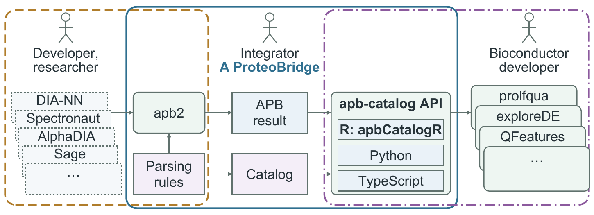

```{r setup, include = FALSE}
knitr::opts_chunk$set(collapse = TRUE, comment = "#>")
```

# Introduction

The AnnData Proteomics Bridge (APB) converts the reports of quantification
software such as DIA-NN, Spectronaut or MaxQuant into one result layout. The
columns keep the vendors' names, so a posterior error probability is `PEP` in
MaxQuant and `EG_PEP` in Spectronaut. apb-catalog records what each column
means; apbCatalogR implements its API in R, so an R application asks for a
meaning and gets the column or its data.

The package works on a bundle apb-catalog releases: the reviewed catalogue sets
and the levels apb2 converts for each software version. One bundle ships with
the package, together with a test bundle of synthetic results and the answers
apb-catalog gives on them.

```{r actors, echo = FALSE, out.width = "100%"}
#| fig.cap: >
#|   Who does what. The integrator converts the results of quantification
#|   software such as DIA-NN, Spectronaut, AlphaDIA and Sage with apb2 and its
#|   parsing rules into an APB result, and fills the catalog. Bioconductor
#|   applications such as prolfqua, exploreDE and QFeatures read the result by
#|   meaning through the apb-catalog API: apbCatalogR in R, apb-catalog in
#|   Python, apb-catalog-ts in TypeScript.

```

The main calls:

- `Catalog$new(software, version, set)`: the fields a version reports
- `read_parsed_levels(path)`: an APB result, one anndataR `AnnData` per level
- `DataCatalog$new(result, ...)`: the data of a result, looked up by key
- `catalogues()`, `catalogue_table()`: the sets and their entries
- `rule_coverage()`: how each software version covers a set
- `catalog_version()`, `update_catalog()`: the bundle in use, and installing one

# Installation

```{r install, eval = FALSE}
install.packages(c("BiocManager", "remotes"))
BiocManager::install("anndata-omics-bridge/apbCatalogR")
```

```{r version}
library(apbCatalogR)
catalog_version()
```

# Catalogue sets

Each catalogue set serves one kind of consumer, and each holds the fields one
producer writes: `apb_alpha` what `apb2 convert` writes,
`fasta_peptides_alpha` what `apb-fasta verify-peptides` adds,
`fasta_proteins_alpha` what `apb-fasta merge-annotations` adds, and
`obs_annotation_alpha` the sample annotation `apb2 annotate` attaches:

```{r sets}
catalogues()[, c("catalogue", "has_requirements", "entries")]
```

`catalogue_table()` lists the entries of a set, one row per field and software
version pattern:

```{r table}
entries <- catalogue_table("confidence_alpha")
columns <- c("software_version_pattern", "level", "name", "key")
entries[entries$source == "Spectronaut", columns]
```

# Which column a software version reports

`Catalog` answers from the catalogue alone, without data. Its `levels` are the
levels apb2 converts for that software version, each with the slots `layers`,
`var` and `obs`, holding field names:

```{r catalog}
catalog <- Catalog$new("DIA-NN", "2.2.0", "abundance_alpha")
catalog
catalog$levels$peptidoform_ion$layers$keys()
catalog$levels$peptidoform_ion$layers[["intensity"]]
catalog$levels$protein$layers[["intensity_norm_settings"]]
```

`[` on `var` or `obs` names every column the keys read. Spectronaut 21 reports
two protein q-values:

```{r catalog-var}
spectronaut <- Catalog$new("Spectronaut", "21.0", "confidence_alpha")
spectronaut$levels$protein$var$keys()
spectronaut$levels$protein$var[c("q_value", "library_q_value")]
```

`$fields()` lists every catalogued field of the version as a table; each
entry's id names the software, version, level and slot where the field lives:

```{r catalog-fields}
spectronaut$fields()[, c("key", "entry_id")]
```

# The data of a result

`read_parsed_levels()` reads a result apb2 wrote, `.parquet`, `.h5ad` or
`.duckdb`, into `ParsedLevels`, one anndataR `AnnData` per level. The test
bundle carries synthetic Parquet results; this one has MaxQuant's
peptidoform-ion level.

```{r read}
results <- tempfile()
archive <- system.file(
    "extdata", "test-bundle", "results.tar.gz",
    package = "apbCatalogR"
)
utils::untar(archive, exdir = results)
result <- read_parsed_levels(
    file.path(results, "maxquant_wide-peptidoform_ion.parquet")
)
result
result$levels$peptidoform_ion
```

`DataCatalog` answers on the result and hands back the data. It composes the
named sets alone: `apb_alpha`, APB's own fields, answers only when named.

```{r data-catalog}
confidence <- DataCatalog$new(result, "confidence_alpha", "apb_alpha")
pep <- confidence$levels$peptidoform_ion$layers[["pep"]]
dim(pep)
```

`$fields()` lists the catalogued fields the result holds, from both sets:

```{r data-fields}
confidence$fields()[, c("set", "location", "name", "key", "present")]
```

Each level of the catalog has anndataR's slots. A name is read as a key first,
then as the level's own layer or column, as cf_xarray reads `ds.cf[...]`:

```{r levels}
ion <- confidence$levels$peptidoform_ion
dim(ion$layers[["pep"]])            # a matrix, runs x features
ion$layers$keys()                   # a character vector
head(ion$var[["peptidoform_ion"]])  # a vector, one value per feature
```

The slots read the anndataR `AnnData` of the level, so a key gives the same
data as the vendor's name in anndataR. A vendor's own name still reads, and `[`
gives a data frame, as on anndataR's `obs` and `var`:

```{r anndatar}
# The anndataR AnnData of the level
adata <- result$levels$peptidoform_ion
identical(ion$layers[["pep"]], adata$layers[["PEP"]])
identical(ion$X, adata$X)
ion$obs_names
ion$var_names
# MaxQuant's own layer, as adata$layers[["Score"]]
ion$layers[["Score"]]
# A data frame, as adata$obs[c("Raw_file", "Experiment")]
ion$obs[c("Raw_file", "Experiment")]
# Keys, each column named as the result names it
ion$var[c("peptidoform_ion", "decoy", "contaminant")]
```

A vendor may name a column as a key is named, as Sage names its quantification
q-value `q_value`. A prefix makes the lookup exact: a set's prefix asks that set
alone and never the level's own field, `v:` the level's own field alone and
never the catalog. `catalogues()` lists each set's prefix:

```{r prefixes}
ion$layers$name("c:pep")    # the confidence set alone
ion$layers$name("v:Score")  # MaxQuant's own layer alone
catalogues()[, c("catalogue", "prefix")]
```

MaxQuant reports no q-value on this level, so `$get()` gives `NULL`, where
`[[` signals an error; `$name()` names the field a key reads:

```{r missing}
ion$layers$get("q_value")
ion$layers$name("pep")
```

A lookup the catalogue cannot answer with one field signals `UnresolvedField`
rather than choosing silently. Spectronaut does not document how its protein
quantity combines the precursors, so asking for a summed one is unknown there:

```{r unresolved}
spectronaut <- Catalog$new("Spectronaut", "21.0", "abundance_alpha")
tryCatch(
    spectronaut$levels$protein$layers$get(
        "intensity_norm_settings",
        aggregation = "sum"
    ),
    UnresolvedField = function(condition) conditionMessage(condition)
)
```

# The same code for every software

The same lookup reads each software's field; the test bundle holds results of
many:

```{r vendors}
files <- c(
    MaxQuant = "maxquant_wide-peptidoform_ion.parquet",
    Spectronaut = "spectronaut_v21-peptidoform_ion.parquet",
    `DIA-NN` = "diann_v2-peptidoform_ion.parquet"
)
pep_field <- function(file) {
    vendor <- read_parsed_levels(file.path(results, file))
    catalog <- DataCatalog$new(vendor, "confidence_alpha")
    catalog$levels$peptidoform_ion$layers$name("pep")
}
vapply(files, pep_field, character(1))
```

A protein level reads the same way; DIA-NN's MaxLFQ intensity, normalized as
the run's settings chose, is the key `intensity_norm_settings`:

```{r protein}
diann <- read_parsed_levels(file.path(results, "diann_v2-protein.parquet"))
protein <- DataCatalog$new(diann, "abundance_alpha")$levels$protein
protein$layers$keys()
protein$layers$name("intensity_norm_settings")
protein$layers[["intensity_norm_settings"]]
```

# Several sets and qualifiers

`DataCatalog$new()` composes several sets on one result. A key may leave a
qualifier open, such as the unit of a retention time; `$get()` and `$name()`
narrow it, and a lookup no field answers gives `NULL`:

```{r compose}
both <- DataCatalog$new(result, "confidence_alpha", "chromatography_alpha")
both
rt <- both$levels$peptidoform_ion
rt$layers$keys()
rt$layers$name("retention_time", unit = "minute")
rt$layers$get("retention_time", unit = "second")
```

# Sets an app or an annotation answers

A set of an app's fields answers once the app has run, and the sample
annotation once `apb2 annotate` has attached it. Opening such a set on a result
that lacks them is an error that says what to run:

```{r producers}
tryCatch(
    DataCatalog$new(result, "fasta_peptides_alpha"),
    error = function(condition) conditionMessage(condition)
)
```

`DataCatalog$answering_sets()` lists the sets a result opens, without an error,
so a consumer can leave out the fields of an app that has not run:

```{r answering}
DataCatalog$answering_sets(result)
```

# Requirements

A set may require or recommend fields. `enforce` checks them once, when the
catalog opens: `"required"` signals one `MissingRequiredField` listing every
missing required field and warns about missing recommended ones;
`"recommended"` signals for both. MaxQuant's peptidoform level lacks a
recommended field of `apb_alpha`:

```{r enforce}
peptidoform <- read_parsed_levels(
    file.path(results, "maxquant_wide-peptidoform.parquet")
)
tryCatch(
    DataCatalog$new(peptidoform, "apb_alpha", enforce = "recommended"),
    MissingRequiredField = function(condition) conditionMessage(condition)
)
```

# Rule coverage

`rule_coverage()` checks every rule against one set; a set with requirements
judges each level:

```{r coverage}
coverage <- rule_coverage("abundance_alpha")
unique(coverage[, c("software", "version", "level", "verdict")])[1:5, ]
```

# A newer catalog

`update_catalog()` installs a bundle archive into the user cache; later
sessions use the newest bundle, shipped or installed. apb-catalog's
`make bundle` writes the archive. Nothing is downloaded.

```{r update, eval = FALSE}
update_catalog("apb-catalog/build/apb-catalog-bundle.tar.gz")
```

# Session information

```{r session}
sessionInfo()
```
